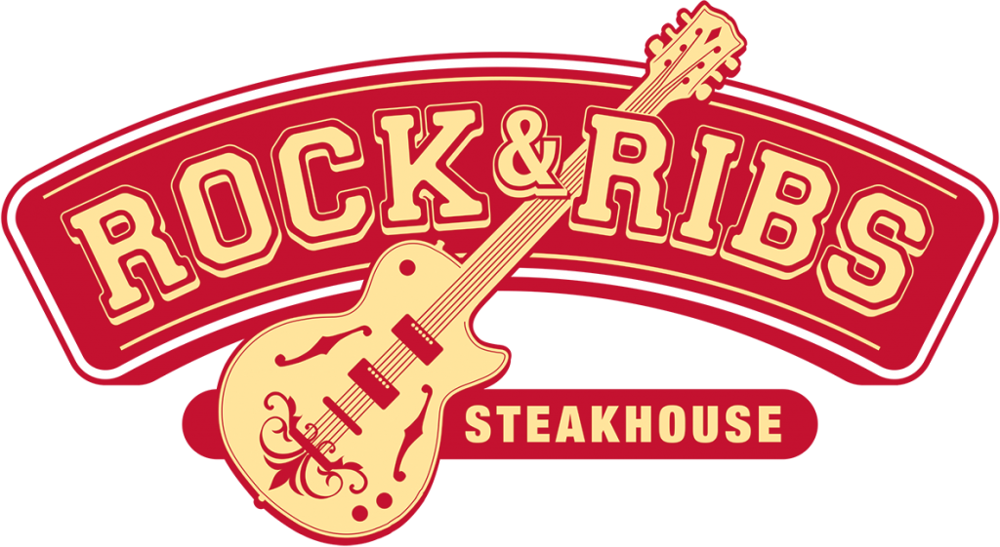

# Rock & Ribs — Volta Redonda



> Steakhouse, boliche, música ao vivo e experiências para reunir a galera em Volta Redonda — RJ.

## Sobre o projeto

O **Rock & Ribs Volta Redonda** é um site institucional desenvolvido para transformar a presença digital da unidade em uma experiência tão envolvente quanto o espaço físico. A proposta vai além de uma página informativa: ela apresenta o restaurante, facilita reservas, divulga promoções e shows, disponibiliza o cardápio e aproxima o público da atmosfera de música, gastronomia e entretenimento da casa.

Em um único lugar, o visitante pode descobrir o que acontece na unidade, conhecer as pistas de boliche, consultar o menu, acessar a carta de vinhos, assistir a conteúdos oficiais do Instagram e iniciar uma reserva.

## Objetivo

O projeto foi estruturado para guiar a navegação de forma natural — da primeira impressão à ação desejada. A página inicial destaca os principais pilares da marca e conduz o usuário por seções dedicadas a:

- Experiências da unidade: steakhouse, boliche, música ao vivo e ambiente temático;
- Programação de atrações e showcase;
- Promoções semanais, como Happy Hour, TPM, Quarta do Gin e Executivo;
- Cardápio completo e carta de vinhos;
- Galeria com fotos reais do ambiente, clientes e drinks;
- Reels oficiais incorporados diretamente do Instagram;
- Eventos corporativos, aniversários e confraternizações;
- Pesquisa de satisfação;
- Informações de localização, funcionamento e reservas.

## Funcionalidades

### Cardápio e carta de vinhos

O cardápio da unidade é apresentado dentro do site, com acesso rápido ao cardápio completo e à carta de vinhos oficial. Isso permite que o cliente encontre todas as informações gastronômicas antes da visita.

### Boliche e reservas

A área de boliche reúne informações de disponibilidade, duração de partida, horário de funcionamento, capacidade e preço. Os botões de ação direcionam o visitante para o fluxo de reserva.

### Showcase e promoções

A programação de artistas recebe destaque visual em cards próprios. Já a área de promoções organiza as ofertas da semana em abas, deixando a consulta rápida no desktop e no celular.

### Galeria conectada ao Instagram

A galeria utiliza registros reais do Rock & Ribs e inclui Reels oficiais incorporados. As fotos são padronizadas visualmente, com recorte centralizado e layout responsivo.

### Pesquisa de satisfação

Após conhecer o cardápio, o usuário encontra uma chamada para a pesquisa de satisfação, conectada ao formulário oficial da unidade.

## Tecnologias utilizadas

- **HTML5** para a estrutura semântica do conteúdo;
- **CSS3** para identidade visual, grids, responsividade e animações;
- **JavaScript puro** para navegação mobile, filtros, carrosséis e interações;
- **Google Fonts** para as famílias tipográficas da identidade;
- **Elfsight** para reprodução do perfil no Instagram;
- **Google Maps** e links externos para localização, cardápio, carta de vinhos e pesquisa.

O projeto é estático e não depende de etapa de compilação ou instalação de pacotes.

## Estrutura do repositório

```text
.
├── index.html                  # Página principal e conteúdo das seções
├── public/
│   ├── image/                  # Logos, fotos, cardápio, galeria e assets visuais
│   └── styles/
│       └── styles.css          # Estilos, layout e responsividade
├── scripts/
│   └── main.js                 # Filtros, navegação e comportamentos da interface
└── README.md
```

## Integrações e referências

- [Instagram — @rockeribsvr](https://www.instagram.com/rockeribsvr/)
- [Cardápio Online](https://rockeribs.com.br/cardapio-volta-redonda/)
- [Carta de Vinhos](https://sites.google.com/view/cartadevinhosrrvr/início)
- [Pesquisa de Satisfação](https://docs.google.com/forms/d/e/1FAIpQLSee6fH2uhDZIUCQLwg3anQLV73H33clWyIUBICKSz3h2vyItw/viewform)

## Próximas evoluções

- Integração de formulário de reservas com atendimento em tempo real;
- Painel administrativo para atualizar atrações, promoções e galeria;
- Sincronização automatizada com conteúdos recentes do Instagram;
- Métricas de navegação e conversão de reservas;
- Versão multilíngue para visitantes internacionais.

---

Desenvolvido para o **Rock & Ribs Volta Redonda**. 🤘
